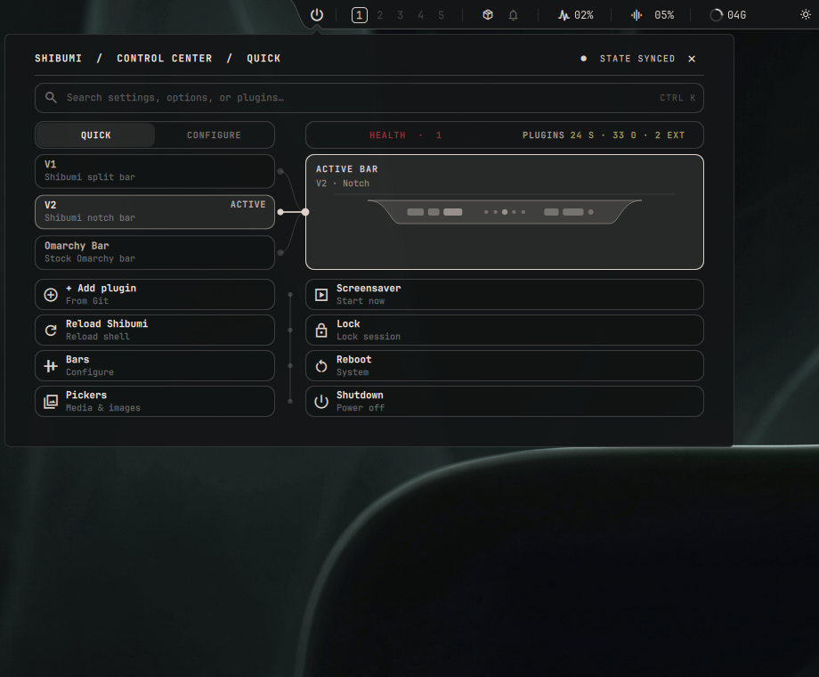
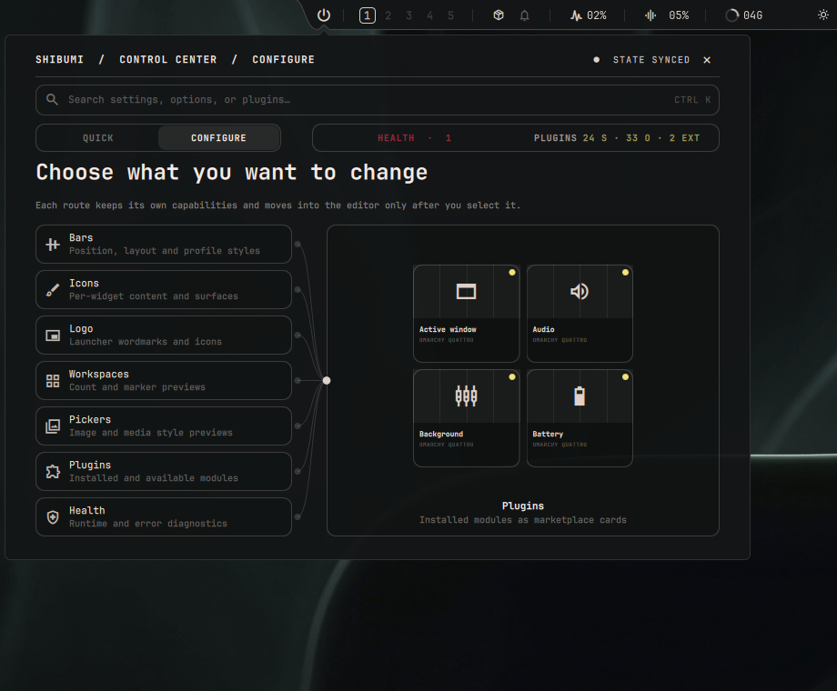
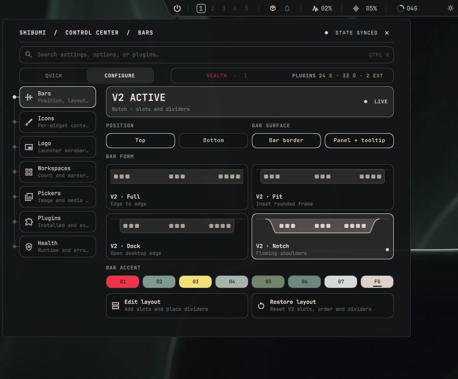
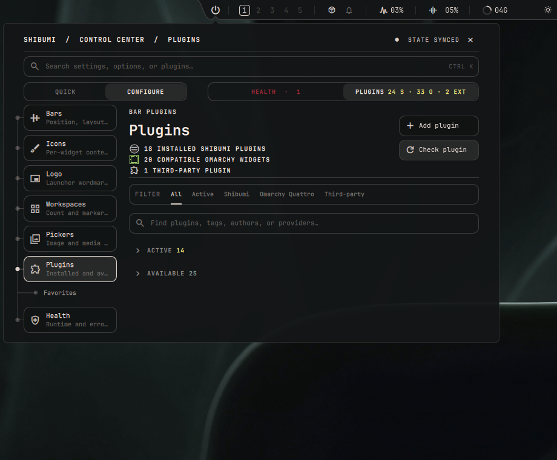

<div align="center">

# Shinigami Shell

<h3>A native bar and plugin suite for Omarchy Quattro</h3>

<p>27 plugins for Omarchy's existing Quickshell process, with V1 and V2 bar
styles and independently configurable widgets.</p>

[Get started](docs/getting-started.md) ·
[Plugin catalog](docs/plugins/README.md) ·
[Documentation](docs/README.md)

</div>

## What’s in Shinigami

- **Bar styles** include V1 and the V2 Full, Fit, Dock, and Notch layouts. The Control Center manages the active style and widget placement.
- **Display Manager** combines monitor configuration, scaling, text size, and brightness. Scroll over the widget to adjust brightness.
- **Wallpaper Manager** opens the wallpaper picker. Middle-click cycles wallpapers across displays.
- **Indicators** show recording, Do Not Disturb, Stay Awake, and Voxtype status beside the clock.
- **OneDrive** has its own sync-status widget and account panel. Quick Access provides themes, idle inhibition, and screenshot and video pickers.

## Interface reference

These captures come from Shibumi Shell and show the interface the port builds on. [Port details](docs/shinigami-port.md)

<table>
  <tr>
    <td align="center" width="50%">
      <strong>Quick</strong><br>
      
    </td>
    <td align="center" width="50%">
      <strong>Configure</strong><br>
      
    </td>
  </tr>
  <tr>
    <td align="center" width="50%">
      <strong>Bars</strong><br>
      
    </td>
    <td align="center" width="50%">
      <strong>Plugins</strong><br>
      
    </td>
  </tr>
</table>

## Install

Use a clean Shinigami Git checkout on Omarchy Quattro. The installer requires
a committed Git revision even for a dry run. A source archive or a directory
copied without its Git metadata cannot run the installer.

1. In an unlocked Omarchy desktop session, open a terminal at the checkout
   root and install the dependencies.

   ```bash
   sudo pacman -S --needed git quickshell python python-dbus iputils glib2 systemd jq curl networkmanager omarchy-power-profiles-daemon upower xdg-utils libnotify wl-clipboard ttf-material-symbols-variable ttf-jetbrains-mono-nerd-basic noto-fonts-cjk adwaita-fonts
   ```

2. Preview the targets and check that the command succeeds.

   ```bash
   ./scripts/shinigami-suite install --dry-run
   ```

3. Install as your desktop user and confirm the prompt. The installer switches
   from the current bar to Shinigami and restarts the Omarchy shell automatically.

   ```bash
   ./scripts/shinigami-suite install
   ```

The package scaffold is for local builds. For updates or installation while
keeping the current bar, see the [installation guide](docs/install.md).

## Uninstall

For a package installation, remove the managed plugins and then the package.

```bash
shinigami-shell uninstall --yes && omarchy pkg drop shinigami-shell
```

For a source installation, run this from the checkout root.

```bash
./scripts/shinigami-suite uninstall --yes
```

[Uninstall options and settings preservation](docs/install.md#uninstall)

## Documentation

- [Install, update, repair, or remove Shinigami](docs/install.md)
- [Configure the shell](docs/configuration.md)
- [Use Shinigami plugins with other bars](docs/plugin-compatibility.md)
- [Troubleshoot a problem](docs/development/troubleshooting.md)
- [Understand the architecture](docs/architecture/overview.md)
- [Check Omarchy Quattro compatibility](docs/architecture/quattro-compatibility.md)

## Credits

**guiestrela** maintains Shinigami. The project builds on HANCORE’s Shibumi Shell and ports widgets from QS Rise. Lacuna Shell by **OldJobobo** inspired the plugin-suite structure. [Upstream release notes](.github/release-notes/v0.2.5.md) · [Lacuna Shell](https://github.com/OldJobobo/lacuna-shell)

[Contributing](CONTRIBUTING.md) · [Changelog](CHANGELOG.md) ·
[MIT License](LICENSE)
